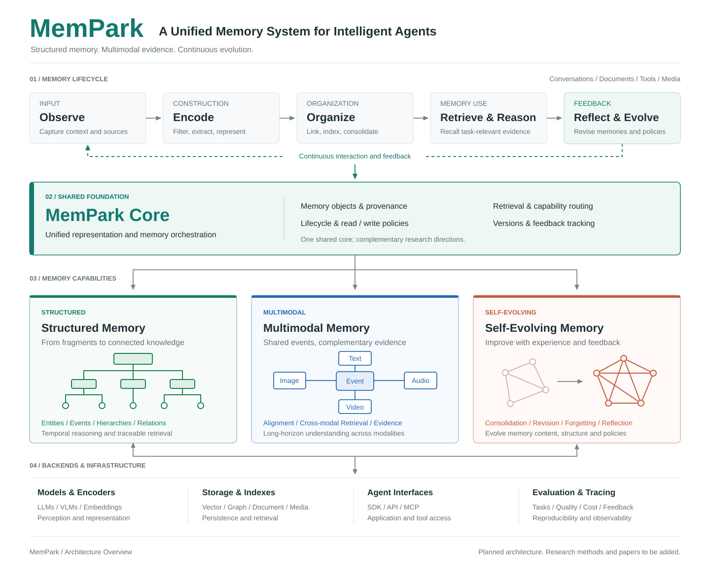

<div align="center">

# MemPark

### A Unified Memory System for Intelligent Agents

**Structured Memory · Multimodal Memory · Self-Evolving Memory**

面向智能体的统一记忆系统：让记忆有结构、跨模态、能进化。

<a href="https://github.com/zhugaofeng1027/MemPark"></a>


[项目愿景](#vision) · [整体架构](#architecture) · [研究方向](#research) · [论文](#papers) · [路线图](#roadmap)

</div>

---

<a id="vision"></a>

## 项目愿景

**MemPark** 旨在构建面向大语言模型、多模态模型和长期运行智能体的统一记忆系统。我们关注的不只是“存下历史、检索片段”，而是让智能体能够组织经历、关联不同模态的证据，并在持续交互中更新记忆与使用策略。

项目以 **MemPark Core** 为共享基础，围绕三个相互协同的研究方向展开：

| 方向 | 核心问题 | 目标能力 |
| :--- | :--- | :--- |
| **Structured Memory / 结构化记忆** | 如何从零散片段形成可推理的记忆结构？ | 实体与事件组织、层次抽象、时序与关系建模 |
| **Multimodal Memory / 多模态记忆** | 如何把不同模态的观察组织成共同的经历？ | 文本、图像、音频、视频的事件对齐与跨模态检索 |
| **Self-Evolving Memory / 自进化记忆** | 如何让记忆及其使用策略随经验持续改进？ | 巩固、修正、遗忘、反思与反馈驱动的策略更新 |

> 当前仓库为项目规划与展示框架。下图和能力描述是目标设计，尚不代表已实现；具体论文与实验结果暂留空。

<a id="architecture"></a>

## 整体架构

<div align="center">
  
</div>

### 共享核心

**MemPark Core** 连接记忆的写入、组织、检索、使用和更新，为不同研究方向提供共同的记忆对象、数据流与评测边界。

| 层次 | 规划职责 |
| :--- | :--- |
| **Memory Lifecycle** | 感知输入、筛选编码、组织存储、检索推理、反馈更新 |
| **MemPark Core** | 统一记忆表示、生命周期编排、检索路由、版本与来源追踪 |
| **Memory Capabilities** | 结构化、多模态、自进化能力独立研究，也可组合使用 |
| **Infrastructure** | 模型与编码器、存储与索引、智能体接口、评测与可观测性 |

### 记忆生命周期

1. **Observe / 感知**：接收对话、文档、工具轨迹及多模态观察，保留原始来源。
2. **Encode / 编码**：筛选有效信息，提取记忆单元与证据，形成可组织的表示。
3. **Organize / 组织**：关联实体、事件、时间与模态，构建层次和关系索引。
4. **Retrieve & Reason / 检索推理**：根据当前任务召回相关记忆，组合证据并提供上下文。
5. **Reflect & Evolve / 反思进化**：结合新观察和任务反馈修正、巩固或遗忘记忆，改进后续使用策略。

这是一条持续循环的数据流，而非一次性入库流程。三个研究方向共享这一生命周期，不限定为三套彼此独立的系统。

<a id="research"></a>

## 研究方向

### Structured Memory

**从记忆片段到可推理的知识与经历结构。**

围绕实体、事件与关系组织记忆，保留“谁在何时做了什么”的绑定，并连接跨事件线索。探索从细粒度事实到事件、主题和长期知识的层次化表示，支持时间约束、多跳关联与来源追溯。

**关注点：** 事件绑定 / 实体关联 / 层次组织 / 时序关系 / 结构化检索

[方向文档](./docs/structured-memory.md)

### Multimodal Memory

**从单一文本到跨模态、可追溯的共同经历。**

将文本、图像、音频和视频中的观察对齐到共同事件，既保留原始模态证据，也构建用于检索与推理的关联表示。探索跨模态查询、长视频事件记忆，以及多来源证据的互补与冲突处理。

**关注点：** 事件对齐 / 模态关联 / 跨模态检索 / 长时序理解 / 证据回溯

[方向文档](./docs/multimodal-memory.md)

### Self-Evolving Memory

**从静态存储到持续更新的记忆与使用策略。**

利用新观察、交互结果和任务反馈，持续调整记忆内容、组织关系及读写策略。探索重复记忆合并、过时信息修正、选择性遗忘、经验抽象与反思，避免把“不断追加记录”等同于“自进化”。

**关注点：** 记忆巩固 / 冲突修正 / 选择性遗忘 / 经验反思 / 策略演化

[方向文档](./docs/self-evolving-memory.md)

<a id="papers"></a>

## 论文与研究成果

<!-- 后续在对应方向补充真实论文题目、链接和成果状态。空白单元格有意保留。 -->

| 研究方向 | 论文题目 | 论文链接 | 发表信息 | 代码 |
| :--- | :--- | :--- | :--- | :--- |
| Unified Memory System | | | | |
| Structured Memory | | | | |
| Multimodal Memory | | | | |
| Self-Evolving Memory | | | | |

论文登记与引用信息预留于 [papers/README.md](./papers/README.md)。

<a id="evaluation"></a>

## 评测与实验

计划从任务效果、记忆质量和系统开销三个层面评估，覆盖各方向的独立贡献与组合效果。数据集、基线、实验配置和结果将在研究确定后补充。

| 维度 | 拟关注内容 | 数据集 | 结果 |
| :--- | :--- | :--- | :--- |
| 长期记忆 | 跨会话问答、用户信息保持、时序更新 | | |
| 结构化推理 | 事件绑定、关系检索、多跳推理 | | |
| 多模态理解 | 跨模态检索、事件理解、证据定位 | | |
| 持续演化 | 信息修正、知识保持、反馈利用 | | |
| 效率与成本 | 存储占用、调用量、Token 开销、读写延迟 | | |

[评测规划与结果占位](./docs/evaluation.md)

<a id="roadmap"></a>

## 路线图

### 项目框架

- [x] 明确统一记忆系统的项目定位。
- [x] 建立整体架构与三个研究方向的文档入口。
- [x] 预留论文、评测与成果展示位置。

### 核心与基础能力

- [ ] 确定统一记忆表示与生命周期设计。
- [ ] 建立基础记忆写入、检索与更新流程。
- [ ] 确定存储、模型与智能体接入方式。

### 研究方向

- [ ] 结构化记忆：表示、组织与推理。
- [ ] 多模态记忆：对齐、检索与证据关联。
- [ ] 自进化记忆：巩固、修正与反馈驱动更新。
- [ ] 验证三个方向之间的协同机制。

### 评测与发布

- [ ] 确定评测任务、数据集与对照基线。
- [ ] 补充实验结果、消融分析与复现材料。
- [ ] 发布论文、代码与使用示例。

## 项目导航

```text
MemPark/
├── README.md                       项目主页
├── assets/
│   └── mempark-architecture.svg     可编辑的整体架构图
├── docs/
│   ├── structured-memory.md        结构化记忆方向
│   ├── multimodal-memory.md        多模态记忆方向
│   ├── self-evolving-memory.md     自进化记忆方向
│   └── evaluation.md               评测规划与结果占位
└── papers/
    └── README.md                   论文与引用信息占位
```

## 致谢

项目组织与架构展示参考 [LightMem](https://github.com/zjunlp/LightMem)。感谢其对统一记忆框架及多方向研究组织方式的启发。
